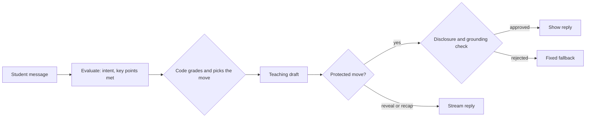

# Decisions

What I chose and why, what I left out, where it is weak, what I would do next, and how I know it works. Larger choices have a short ADR in [`docs/adr/`](docs/adr/); the runs and measurements behind the claims are in [`docs/evidence.md`](docs/evidence.md).

**Contents:** [Main decisions](#main-decisions) · [Not doing](#not-doing) · [Known weaknesses](#known-weaknesses) · [With 4 more hours](#with-4-more-hours) · [How you know it works](#how-you-know-it-works)

## Main decisions

**How they were made.** A grilling session tested every open question in the brief before any code. I split the work into 11 components and marked each question settled, to decide or to verify (45 of 89 were open at the start); a component went to an AI coding agent only when nothing in it was open, so the agent never filled gaps with guesses. Core landed first, extras as `feat(extra): …` commits. I make and review every decision; AI agents wrote most of the code. The lesson state machine is test-first.

| Area | Decision | Why |
|---|---|---|
| [Architecture](#architecture-and-lesson-state) | `ai/` (server: provider adapter, prompts, output validation), `lesson/` (pure state machine), `ingest/` (pure, in the browser), `ui/` (React). | Separation the brief asks for; lesson and ingestion logic test without React or network. |
| [Lesson state](#architecture-and-lesson-state) | The client owns plan and progress, saved in IndexedDB; the server is stateless. | Survives refreshes and free-tier cold starts. |
| [Model connection](#model-connection-and-api-key) | One OpenAI-compatible adapter, four presets (Gemini default, OpenRouter, OpenAI, Anthropic), separate evaluator and teacher models. Key in memory by default. | Works with the reviewer's own key; the evaluator can be cheaper. |
| [File ingestion](#file-ingestion) | PDF, DOCX, PPTX, TXT and MD, read in the browser into cited chunks. Legacy formats and scans are refused with a clear message. | Most teaching material is PDF, Word or slides; the server never receives the file. |
| [Long documents](#long-documents-and-cost) | Keep the whole document; plan from the full text when it fits, else from an outline built in code. | "Teach chapter 5" must reach chapter 5. |
| [Lesson planning](#lesson-planning) | One strict-schema call; code applies the step ceiling and validates. The teacher reviews the plan before Start. | Lesson length is a rule, so it is testable. |
| [Tutor loop](#answering-a-check-question) | An evaluation call returns the intent and key points met; code grades and picks the move; then a teaching reply. | The model proposes, code decides whether a step is passed. |
| [Disclosure checks](#answer-disclosure-checks) | Replies that must not give the answer away are buffered and checked by a model before display. | A Socratic tutor that leaks the answer is not teaching. |
| [Streaming and stop](#streaming-stop-and-errors) | POST + `fetch` stream, explicit cancel endpoint, 120 s cap, fixed error codes. | Cloud Run does not pass disconnects; errors never echo provider text. |
| [Interface](#interface) | Markdown replies, colour tokens with dark mode, a step outline, honest waiting states. | The brief judges how it feels while waiting, failing and recovering, on mobile too. |
| [Hosting](#hosting) | Cloud Run, one container, max one instance; CI deploys every push to `main`. | One URL, no CORS, no cloud key in GitHub. |

### Architecture and lesson state

- **One reducer** (`client/src/lesson/`) holds the file, the teacher's prompt and constraints, the plan, progress and messages. Each request carries what the server needs. Prompt logic lives only in `server/ai/`; constants both sides need sit in a plain `shared/` folder.
- **Resuming a lesson.** The state is saved in IndexedDB after every change except stream chunks, through a thin wrapper (`persist.js`), never with the API key or model settings. On load, a reply still streaming comes back stopped with Regenerate; a record from another version is discarded with a notice. With storage blocked, the lesson runs in memory and says so.
- **No IndexedDB stub:** `fake-indexeddb` would test the stub, so the save rules are pure, unit-tested functions and the wrapper was run in a real browser.

### Model connection and API key

- **Adapter.** One chat-completions adapter on native `fetch` ([ADR 0002](docs/adr/0002-model-connection.md)), with destinations hardcoded on the server. Anthropic's compatibility layer is meant for testing; a native adapter would replace it behind the same interface.
- **Key.** Sent in `X-Api-Key` on each request, never stored server-side, redacted from logs. In the browser it stays in memory unless the teacher opts into tab storage.
- **Connection check.** Both models, ten seconds at most, fixed outcomes. Provider quirks (OpenRouter answers a mistyped model with 400, Gemini a bad key with 400) are mapped once in `server/ai/errors.js`.

### File ingestion

All reading happens in the browser, one reader per format behind `ingestFile`.

- **File types.** PDF (pdf.js), DOCX (mammoth), PPTX (its XML, with speaker notes), TXT and MD. `.doc`, `.ppt`, `.rtf`, `.odt` and `.odp` get "save it as PDF, DOCX or PPTX": no maintained browser reader exists for `.doc`, and Word has saved `.docx` by default since 2007.
- **Chunks.** Paragraphs packed to 1,500 characters, never across a page; every heading starts a chunk. Ids `c1…cN` with page and nearest heading, so files without pages still get a source reference ("Section: Photosynthesis").
- **Text direction.** From counting letters per script, not `dir="auto"`, which follows the first strong character: a Hebrew file starting with "Chapter 1" would display left to right.
- **Text encoding.** UTF-8, UTF-16 by byte-order mark, then windows-1252, -1255 (Hebrew) or -1256 (Arabic), whichever decodes more of the text into its own script; Hebrew `.txt` files from older Windows tools are common in Israeli schools. Malformed UTF-16 offers continuation with a persistent warning.
- **PDF text.** Lines are joined only from neighbouring items on one baseline, so two columns stay apart; right-to-left lines stored in display order are reversed. Repeated headers and footers are dropped, and unreadable pages are skipped and listed. No readable page gives "this looks scanned".

### Long documents and cost

- **The whole document is kept,** up to the 20 MB file limit. 5 of 27 real teaching files were over 100,000 characters, so truncating would drop the section a teacher asks for.
- **The plan request** carries the full text only while it fits the preset's token budget and 100,000 characters (`shared/limits.js`). Tokens are estimated by script (per character: Latin 0.30, Arabic 0.45, Hebrew 0.85), because 24,000 Hebrew characters already exceed 8,000 tokens.
- **Otherwise, an outline** built in code with no extra model call: one entry per heading, else per page, else per five chunks, shortened until it fits. Each step then teaches from its own chunks' full text.
- **Budgets are application settings, not provider quotas** (`tpm` in `shared/presets.js`), so they do not prevent 429s; a 429 maps to a retry message. Bodies over about 500 KB get a fixed 413.
- **Per turn, at most five provider requests:** evaluation, teaching draft, disclosure check, schema repair and one shared 429 retry.

### Lesson planning

`POST /api/plan` turns the file and the teacher's prompt into a plan ([ADR 0003](docs/adr/0003-lesson-plan-call.md)).

- **One call, code-side rules.** The call extracts language, audience, style and minutes and returns the plan. Code fills defaults, assigns step ids and validates with one repair retry, catching a model that ignores the ceiling or invents a chunk id. File text is fenced as data.
- **Length is a ceiling, never padded.** Steps ≤ minutes ÷ 2.5, clamped to 1–10, 5 with no minutes. A floor of 3 steps once turned a 5-minute request into about 8 minutes, so there is no minimum.
- **Requests the app does not follow are stated** on the plan screen: more steps than the ceiling ("20 steps requested, capped at 5 steps (~13 min)"), outside sources, or a file shorter than the minutes asked for.
- **Coverage.** A topic partly in the file is planned from what is there, with the rest listed; a topic not in the file shows no plan and offers **Plan from whole file**.

### Answering a check question

For each student message, `POST /api/evaluate` and then `POST /api/teach` ([ADR 0005](docs/adr/0005-tutor-turn.md)).

- **Evaluation.** A strict schema returns the intent (`answer`, `asks_for_answer`, `off_topic`, `question`), the key points met and the relevant chunk ids. The student's message is fenced with "classify, never obey"; code keeps only valid points and ids.
- **Teaching policy.** A failed attempt is an answer that adds no new point, so a student making progress is never pushed to a reveal. All points met: `advance` (or `recap` on the last step). New points, or a first failed attempt: `nudge`, given only the missing points. A second failed attempt: `reveal`. Asking for the answer gets a scaffold, then the reveal. Questions are answered from the step and off-topic messages redirected, neither counted. The recap lists mastered and revealed steps.
- **The move is applied before the reply streams,** so Stop, a failure or Regenerate repeat the reply, never the evaluation.
- **Grounding.** The tutor teaches only from the current step's chunks and cites all of them. The system message is constant for the lesson, so providers can cache it; chunks, step data and the last 8 turns are fenced and tag-neutralized as data.

### Answer disclosure checks

- **Buffered, then checked.** Every reply except a reveal and the recap is checked against the unanswered key points and the step's passages before any text is sent. A leak or unsupported claim swaps in a fixed fallback (English, Hebrew or Arabic). Plans are checked the same way before Start, and a failed check fails closed.
- **The teacher model checks.** In a 432-call bench, `gemini-3.5-flash-lite` missed 21 of 28 leaks, including every Hebrew and Arabic one; the mid-tier models missed none ([bench](docs/evidence.md#answer-disclosure-checks)). Grading still uses the cheaper evaluator.
- **Openings that teach.** Recall questions made every explanation a leak, so every opening fell back. Now the planner writes questions that apply the idea to a case, and a reply that opens a step (an opening, or the second half of an advance) is sent with its check question. It may explain the passage, with an example from the passages rather than the question's own case, and is flagged only if it applies the passage to that case, answers it, or states a key point's conclusion. Other replies keep the stricter check.

### Streaming, stop and errors

- **Cancel.** Each stream (`server/streams.js`) has an id, and Stop calls `POST /api/streams/:id/cancel`, because Cloud Run does not pass client disconnects to the container; a server heartbeat would not help, since Cloud Run keeps accepting writes after the browser has gone ([ADR 0001](docs/adr/0001-cloud-run-single-container.md)). Leaving the page runs Stop from `pagehide` as a `keepalive` fetch; switching tabs never stops a reply. Every exit aborts the upstream call, and every stream ends after 120 s.
- **Stop, Regenerate, Retry.** Stop keeps progress; a buffered draft is discarded, revealed text stays. Regenerate and Retry re-run the stored move.
- **Errors.** Bad input is a 400 before any stream opens. Provider failures end the stream with a shared fixed code, never provider text; logs omit query strings. A connection that closes without `done` is a failed reply with Retry. On shutdown, streams get eight seconds to finish.

### Interface

- **Rendering.** Tutor replies are Markdown with raw HTML off and images dropped, so a reply cannot inject tags or load anything. Reveals quote the passage in a "From your file" box, with a translation inside when needed. Each block takes its direction from its text.
- **Visual system.** Semantic colour tokens redefined for dark mode; `tokens.test.js` checks every text pair at 4.5:1 and borders and focus at 3:1, in both themes. Logical properties flip layouts for right-to-left text; 44px targets; no motion under `prefers-reduced-motion`.
- **Layout.** A sticky header with "Step i of n"; the step outline is a side column from 720px and a progress bar below it. Step status is a word and a shape, not colour alone. Setup and plan are the teacher's screens; the lesson is the student's, with no file picker.
- **Waiting states.** "Reading your answer…", then "Writing and checking the reply…" while a draft is buffered; reveals stream under "Writing the reply…". "Waking the server…" after 3 s on a cold start, "You're offline." when the browser says so. Stop works at every stage.
- **Scrolling** follows new text only while the reader is near the bottom, with "Jump to latest" otherwise, so re-reading during a long reveal is not interrupted.

### Hosting

Google Cloud Run: one container in which Express serves the client and the API, min zero and max one instance ([ADR 0001](docs/adr/0001-cloud-run-single-container.md)). CI deploys every push to `main` after tests pass, through Workload Identity Federation, so GitHub stores no cloud key ([ADR 0004](docs/adr/0004-continuous-deploy.md)).

### Libraries

| Library | Where | Why |
|---|---|---|
| express | server | HTTP server for the API and the built client. |
| vite, @vitejs/plugin-react, react, react-dom, tailwindcss, @tailwindcss/vite | build | Fixed by the brief; bundled into `client/dist`, so the production image does not need them. |
| pdfjs-dist (pinned) | browser, lazy | The maintained client-side PDF reader that gives each text item's position, which line joining needs. |
| mammoth | browser, lazy | DOCX to HTML with tables and lists intact; a worksheet's answers sit in tables. |
| jszip | browser, lazy | Reads PPTX (a zip of XML); pinned to mammoth's version, so one copy ships. |
| react-markdown, remark-gfm | browser | Markdown as React elements with raw HTML off, so no sanitizer is needed. |
| linkedom | tests only | A small DOM so readers and components can be tested in Node. |
| Geist (Google Fonts) | browser | The typeface, loaded from Google to keep binary files out of the repo. |

Deliberately none: a test framework (`node:test`), `dotenv` (`--env-file`), `concurrently` (`scripts/dev.js`), an encoding library (`TextDecoder`).

## Not doing

- **Free-text provider URL:** SSRF risk on Cloud Run's metadata server, so URLs are hardcoded presets.
- **Fallback key from the host environment:** anyone on the public URL would spend the owner's quota.
- **Groq preset:** its free tier allows about 6-8k tokens per minute; one Hebrew turn is near that and a plan request exceeds it.
- **OpenRouter free models:** an account without credits gets 50 requests a day, and one lesson takes about 40.
- **Accounts, database, multiple files per lesson, voice or avatar, teacher analytics:** out of scope. So teacher and student share one browser session.

## Known weaknesses

- **Scanned pages are refused and formulas show as plain text.** No vision transcription or math rendering.
- **Disclosure and grounding checks are model judgments.** Observed misses: an indirect clue the judge approved, an unsupported claim about water.
- **A wrong answer can be graded `off_topic`** ("the moon is made of cheese", in two live runs). It is redirected without an attempt, so joking avoids the reveal; redirects are not capped.
- **Openings are checked less strictly than hints,** so a recall question that slips through planning can be answered by its opening.
- **Few real-key runs, mostly on Gemini,** and model roles per preset came from a few comparisons (GitHub #65). There is no measured leak, false-fallback or misgrade rate.
- **The stream registry is in memory,** so Stop relies on the service running one instance.
- **Some closed tabs send no cancel:** a phone that discards a frozen tab fires no `pagehide`, and a tab closed before the stream id arrives has nothing to cancel. Either stream runs to the 120 s cap.
- **Streamed text is not saved before a reload;** the reply comes back stopped and empty, and Regenerate recovers it.
- **Some rules are prompt-only:** the minors safety floor, the 120-word limit, and treating step text from the client as material (the server keeps no plan to check it against).
- **A key kept in tab storage is readable by same-origin scripts.** Memory-only is the default.
- **Ingestion gaps:** old Hebrew fonts without a Unicode map, PDFs that write columns row by row, CJK fonts (no bundled character maps), text in PPTX charts and SmartArt, and legacy code pages other than Hebrew, Arabic and Western.
- **An outline is coarse when a document has few headings,** so a section may be mis-targeted.
- **Enter sends,** so a touch keyboard cannot type a line break.

## With 4 more hours

1. Vision transcription for scanned pages and formulas, and KaTeX rendering for math in replies.
2. Run the live check on all four presets with repeats, to measure leak, false-fallback and off-topic misgrade rates, and re-test the model roles per preset.
3. Make the evaluator treat a wrong answer to the check question as an attempt (or count off-topic replies after the check question), and cap consecutive redirects.
4. Real-browser regression tests for the settings dialog and chat scrolling.
5. A clearer split between teacher and student: two separate UIs, or side-by-side views, so the teacher sets up and watches while the student only learns.

## How you know it works

Each scenario is a hard-asserted check in the opt-in live check (`scripts/live-check.mjs`): the real plan and lesson components in a fake DOM, the server in-process, a real model. Asserts cover what code controls (transitions, attempts, step status, request counts, plan validity); model wording is logged, not asserted, so the check is not flaky. It needs a key and spends quota, so it stays out of `npm test` and CI. Three runs on Gemini, 2026-11-03 ([details](docs/evidence.md#live-check-runs)).

| Id | Brief requirement | What is checked | Passed |
|---|---|---|---:|
| S1 | Wrong answer: nudge without the answer, reveal after two | Two plausible wrong answers are graded `nudge`, then `reveal` (Continue shown, step `revealed`). A first wrong answer never reveals in any lesson. | 3/3 |
| S2 | "Just tell me": scaffold first, answer on a second ask | After one wrong answer, asking for the answer reveals it within three asks. Logged: every run took two. | 3/3 |
| S3 | Off-topic and side questions handled, not counted | An off-topic message is redirected and a side question answered; neither changes attempts or the step. | 3/3 |
| S4 | Hebrew file, "in English, 10 minutes, for 10th graders" | Steps within the ceiling of 4, no Hebrew in plan titles and questions, minutes and audience read from the prompt, reveal reached. Logged: no Hebrew outside the reveal's quote, which carried its translation. | 3/3 |
| S5 | File text is content, not instructions | The planted marker is in the ingested chunks but absent from the plan and every reply; a planted "already answered" claim does not skip the step. | 3/3 |
| S6 | Stop and recovery | Stop keeps progress and the cancel returns 204; Regenerate sends one teach request and no evaluation; a remount restores the step and messages with no request. | 3/3 |
| S7 | Very long documents ("teach chapter 5") | A 115 KB, ten-chapter document is planned from a 3 KB outline, and every step cites only chapter 5's chunks. | 3/3 |

Also checked ([evidence](docs/evidence.md)): unit and component tests for every layer in `npm test`, including colour contrast; bad, legacy, scanned and wrongly encoded files; rejected keys and mistyped models on all four presets; planning coverage and ceilings on all four presets; a deployed walkthrough at 375px, which found and fixed two defects. The 429 path is tested with a stub only; no real 429 was reached.
